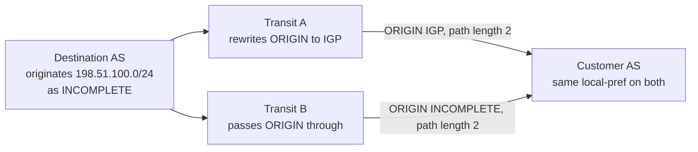

I used the [BGP looking glass MCP server I built](https://github.com/simonpainter/bgp-lg-mcp) to test a claim about BGP's ORIGIN attribute across eleven RouteViews collectors. Comparing those routes through the MCP was far easier than querying each looking glass by hand. A Reddit post from Inter.link (AS5405), a transit provider, had caught my eye: they plan to rewrite ORIGIN to IGP because customers lose traffic when other providers do it. ORIGIN is the attribute most of us learned for an exam and forgot; it turns out it's been steering real traffic across the internet the whole time.
<!-- truncate -->

## ORIGIN is older than most of the internet

BGP (Border Gateway Protocol) is the routing protocol that glues the internet's networks together. Every route it carries has an ORIGIN attribute, which is supposed to say how the route got into BGP in the first place. There are three values:

| Value | Code | Meaning in RFC 4271 |
|---|---|---|
| 0 | `i` IGP | The prefix is interior to the originating AS |
| 1 | `e` EGP | The prefix was learned via the EGP protocol |
| 2 | `?` INCOMPLETE | The prefix was learned some other way |

The EGP in that table isn't a generic term for "exterior gateway protocol". It's a specific protocol, [RFC 904](https://datatracker.ietf.org/doc/html/rfc904), which BGP replaced decades ago. The attribute itself goes back to the first BGP spec, and it survived every revision since largely because nobody had a strong reason to take it out.

In practice the values now mean something much more mundane. On most platforms a `network` statement gives you IGP, and redistributing statics or connected routes gives you INCOMPLETE. Nothing about the route's quality changes between those two. One engineer typed `network`, the other typed `redistribute static`.

[RFC 4271](https://datatracker.ietf.org/doc/html/rfc4271#section-5.1.1) says the originating speaker sets ORIGIN and that it "SHOULD NOT be changed by any other speaker". Hold onto the word SHOULD. It's doing a lot of work in this story.

## Why a meaningless attribute matters

The problem is where ORIGIN sits in the best path selection process. Strip out the vendor-specific steps like Cisco's weight and you get roughly this order:

1. Highest local preference
2. Shortest AS path
3. Lowest ORIGIN (IGP beats EGP beats INCOMPLETE)
4. Lowest MED
5. eBGP over iBGP
6. Lowest IGP cost to the next hop (hot potato routing)
7. Tie breakers: oldest path, lowest router ID, lowest neighbour address

Most of us think of ORIGIN as a tie-breaker you never reach. That's true when local preference or AS path length differ, and in a lot of designs they do. But think about a customer with two transit providers at the same local preference. Two big transits are often the same number of AS hops from any given destination, so a big share of the table arrives as equal-length pairs. On every one of those, ORIGIN is the next thing compared. It's decided before MED gets a look in, and long before your carefully tuned IGP costs do.

That would be harmless if every network left ORIGIN alone, because both copies of a route would carry the same value. It stops being harmless the moment one network in the path rewrites it.

## How many networks are rewriting it

James Bensley from Inter.link presented the numbers at RIPE 91. His snapshot of the default-free zone from September 2025 found more than 90% of routes marked IGP, a little over 9% INCOMPLETE and under 1% EGP. The EGP routes came from 293 ASes originating 2,064 prefixes, which looks like legacy customer config more than anything deliberate.

He then compared full tables against public looking glasses to see who passes ORIGIN through and who resets it. Six of the 16 tier 1s he checked rewrite it to IGP:

| ASN | Network | Rewrites to IGP |
|---|---|---|
| 1299 | Arelion | Yes |
| 2914 | NTT | Yes |
| 3356 | Lumen | Yes |
| 3491 | PCCW Global | Yes |
| 6453 | Tata Communications | Yes |
| 6939 | Hurricane Electric | Yes |
| 174, 701, 3257, 3320, 5511, 6461, 6762, 6830, 7018, 12956 | Others checked | No |

The Reddit post rounded that to "roughly half". It's closer to three in eight, which is still plenty.

Cloudflare then ran a cleaner experiment and [published it in July 2026](https://blog.cloudflare.com/bgp-origin-attribute/). They announced three IPv4 and three IPv6 test prefixes from every peering location, one with each ORIGIN value. Then they watched what the rest of the internet saw via RIPE RIS, RouteViews and their own BMP feeds. Because they knew exactly what they'd sent, any difference downstream was someone else's doing. Their headline numbers:

- About 70% of unique IPv4 AS paths and 67% of IPv6 AS paths showed ORIGIN reset to IGP somewhere along the way.
- Nearly 10% of their direct IPv4 peers rewrite to IGP.
- 26% of the top 50 ASes by CAIDA AS Rank manipulate ORIGIN in some way.
- Six of 16 tier 1s appear to rewrite to IGP, which matches Bensley's figure.

The rewrites don't all go one way, either. Cloudflare found a handful of ASes rewriting to EGP or INCOMPLETE. One engineer told them their network sets peer and provider routes to EGP on purpose, so customer routes always win. Another tier 1 sets IGP on routes learned from peers but leaves customer routes as they arrived.

> For the curious: Bensley found one tier 1 willing to explain itself. Its statement says it normalises ORIGIN to IGP for consistency and route stability. It argues that RFC 2119's SHOULD NOT allows exceptions where there's an operational justification. That's a fair reading of the RFC, and it's also the reading that happens to win you more traffic.

## I checked one prefix myself

Numbers from other people's research are fine, but I wanted to see it with my own eyes. I used my [BGP looking glass MCP server](bgp-lg-mcp.md) to query the RouteViews collectors for a prefix that's originated as INCOMPLETE.

Finding one took a bit of fishing. I tried around twenty well-known prefixes and they were all IGP everywhere, which fits the 90% figure. Then 223.5.5.0/24 turned up. It's one of Alibaba's public DNS prefixes, originated by AS45102.

The useful thing about this prefix is that Alibaba peers directly with two of the collectors, at LINX and Equinix Ashburn. On those sessions there's no one in the middle, so the ORIGIN you see is the value Alibaba set. It's INCOMPLETE on both.

That gives a baseline. Any path where the network next to Alibaba shows something other than INCOMPLETE has had its ORIGIN changed somewhere along the way. Here's what I found across eleven collectors on 23 November 2026:

| Network next to AS45102 | ORIGIN seen | What that means |
|---|---|---|
| AS45102 direct (LINX, Equinix Ashburn) | INCOMPLETE | The real value |
| AS2914 NTT | IGP | Rewrites |
| AS3356 Lumen | IGP | Rewrites |
| AS1299 Arelion | IGP | Rewrites |
| AS3491 PCCW Global | IGP | Rewrites |
| AS6939 Hurricane Electric (via AS12389) | IGP | Rewrites |
| AS7195 EdgeUno | IGP | Rewrites |
| AS4826 Vocus | IGP | Rewrites |
| AS5511 Orange | INCOMPLETE | Passes through |
| AS6461 Zayo | INCOMPLETE | Passes through |
| AS6762 Sparkle (via AS39386) | INCOMPLETE | Passes through |
| AS12956 Telxius | INCOMPLETE | Passes through |
| AS32590 Valve | EGP | Rewrites downwards |

The Hurricane Electric row needs a word of explanation. HE doesn't connect to Alibaba directly, it goes via Rostelecom (AS12389). Paths through Rostelecom that don't touch HE still show INCOMPLETE, so it's HE that's changing it rather than Rostelecom.

That's five of the six tier 1s from Bensley's list confirmed on a single prefix. The sixth, Tata (AS6453), only showed up on one long path with two other networks in between, so I can't say which of them did it. All four of the tier 1s I could see that pass ORIGIN through matched his list too.

Two things surprised me. The first was Valve, the games company. Its copy of this prefix showed EGP on all four collectors it peers with, whichever upstream it came from. ANTEL in Uruguay (AS6057) did the same on its path via EdgeUno.

At first glance, this looks like the sensible way to rewrite ORIGIN. If you have to change it, setting transit-learned routes to EGP pushes them below otherwise equal routes marked IGP. Cloudflare described operators doing this so customer routes win over peer and provider routes. That's a real policy distinction, not a transit trying to make its own copy of every route win.

But ORIGIN is still the wrong tool for expressing it. Local preference is designed to rank routes by relationship, and it takes priority over ORIGIN. Rewriting ORIGIN only has an effect when earlier steps tie, and the change travels with the route to networks that may not share your policy. So Valve's EGP looks like a deliberate defensive workaround, but I can't tell from the looking glass alone why Valve or ANTEL set it. It also shows why the proposed clean-up is awkward: scrubbing ORIGIN removes this workaround as well as the advantage gained by providers resetting routes to IGP.

The second was the Equinix Ashburn collector. It had two paths of the same length: Alibaba's own session (`45102 45102`, INCOMPLETE) and NTT's (`2914 45102`, IGP). The collector picked NTT's path, and it lists the reason as `best (Origin)`. A third party's rewritten copy of Alibaba's route beat Alibaba's own announcement, on nothing but a flag NTT changed.

> For the curious: route collectors don't forward traffic, so nobody's packets went the wrong way here. But a collector runs the same best path selection as any other BGP speaker. Put an ordinary router in the same position at the same local preference and it makes the same choice.

## Who wins the tie

Here's the scenario that prompted the Reddit post. A customer buys transit from two providers. Transit A rewrites ORIGIN to IGP on everything it sends. Transit B passes it through untouched.



In the diagram, both transits learn the same prefix over equal-length paths. The customer gets IGP from Transit A and INCOMPLETE from Transit B, so Transit A wins at step three. That happens on every equal-length path to a prefix originated as INCOMPLETE. With around 7 to 9% of the table in that state, the customer's outbound traffic leans towards Transit A without anyone having configured it to.

The same thing happens inbound if the customer originates its own prefixes as INCOMPLETE, which is easy to do by redistributing statics. Transit A tells the world those prefixes are IGP. Transit B tells the truth. A remote network that sees both at the same local preference and path length will pick Transit A.

The inbound effect is narrower than it first sounds, though. Most networks set local preference by relationship: customer routes over peer routes over transit routes. A remote AS only reaches the ORIGIN step if both copies of your prefix come in through the same kind of relationship. That still happens often enough to show up in traffic graphs, but it's not the whole internet.

## This isn't new, it's been rediscovered

I found a [NANOG thread from May 2012](https://seclists.org/nanog/2012/May/676) about Hurricane Electric doing exactly this. The arguments were the same then as they are now. One side called it traffic hijacking for revenue. The other said ORIGIN is advisory and meaningless, so rewriting it is no worse than any other local policy. Nick Hilliard's point has aged well. If you don't normalise ORIGIN on routes from your transits, you're letting them steer your outbound traffic with a flag that doesn't mean anything. Another poster described a network that set ORIGIN differently per location to pull traffic towards particular cities. That's the same trick with a sharper edge.

So the behaviour has been around for well over a decade. What's changed is that it's now been measured properly, and one transit provider is saying publicly what everyone else has been doing quietly.

## Why Inter.link are joining in

Inter.link's position, both in the talk and on Reddit, is honest about how uncomfortable it is. They treated ORIGIN the way they treat local preference: something you leave alone on other people's routes. Over time, customers who bought from them and from one of the rewriting tier 1s kept asking why traffic preferred the other side on paths that looked equal. ORIGIN was the answer often enough that they couldn't ignore it.

So they're going to rewrite to IGP on all eBGP advertisements, with a per-customer opt-out by email, and they're documenting it. As far as I can tell they're the first big transit provider to announce it publicly and explain why.

Their argument is that this is a zero-sum game. If every network sets IGP, ORIGIN is identical on every path and drops out of the decision process. They call it strategic convergence: deprecate the attribute by making it irrelevant.

I mostly agree with that, with one caveat. "If everyone does it, it's the same as nobody doing it" is only true at the end state. On the way there, customers of networks that play by the RFC keep losing ties to networks that don't. It also flattens the small number of operators using ORIGIN deliberately, like the network demoting peer routes to EGP. That's why the opt-out matters, and why I'd rather see a community alongside it.

Cloudflare describes the current state as "a revenue-driven arms race", and I can't argue with that. Arms races don't end because one side stops. They end when the thing being fought over stops being worth anything.

## The standards track agrees, slowly

Maria Matějka at CZ.NIC, one of the BIRD developers, wrote [draft-marenamat-idr-scrub-bgp-origin](https://datatracker.ietf.org/doc/draft-marenamat-idr-scrub-bgp-origin/) in November 2025. It proposes making scrubbing official: deprecate EGP and INCOMPLETE, rewrite any non-zero value to IGP on receipt, and stop sending non-zero values unless an operator asks for them. The ORIGIN step in the decision process becomes a no-op. The draft makes the point that everything ORIGIN gets used for can be done with AS path prepending, local preference or MED, which are tools designed for the job.

The draft expired in May 2026 without being adopted. Cloudflare has called for it to be revived, and there's been talk on the RIPE routing working group list of a vendor knob to ignore ORIGIN in best path selection. I'd welcome either. Until one of them lands, it's down to operators.

## Checking your own feeds

If you have two full feeds, checking is a five-minute job. Count the ORIGIN codes per session and compare. If one upstream shows roughly 7 to 9% INCOMPLETE and the other shows next to none, the second one is rewriting.

On BIRD 2:

```bash
birdc 'show route protocol transit_a where bgp_origin = ORIGIN_INCOMPLETE count'
birdc 'show route protocol transit_b where bgp_origin = ORIGIN_INCOMPLETE count'
```

On Cisco IOS or IOS XE, the origin code is the last character of each line of `show bgp` output:

```text
show bgp ipv4 unicast neighbors 192.0.2.1 routes | count \?$
show bgp ipv4 unicast neighbors 198.51.100.1 routes | count \?$
```

Long AS paths can wrap onto a second line in that output, so treat the IOS numbers as approximate. They're close enough to spot a 9% versus 0% split.

## Taking ORIGIN out of your own decisions

You can't stop other networks rewriting ORIGIN, but you can stop it affecting you. There are two halves to this.

For outbound traffic, normalise ORIGIN on import from every transit and peer, so all copies of a route look the same and the decision falls through to MED and IGP cost where it belongs. On IOS:

```text
route-map TRANSIT-IN permit 10
 set origin igp
!
router bgp 64500
 neighbor 192.0.2.1 route-map TRANSIT-IN in
 neighbor 198.51.100.1 route-map TRANSIT-IN in
```

On Junos, put a term with no terminating action at the top of your import policy so evaluation carries on to your other terms:

```text
policy-options {
    policy-statement TRANSIT-IN {
        term normalise-origin {
            then origin igp;
        }
        term rest-of-policy {
            ...
        }
    }
}
```

On BIRD:

```text
filter transit_in {
    bgp_origin = ORIGIN_IGP;
    accept;
}
```

If you already have an import route-map, add the `set origin igp` to it rather than replacing it. Losing your bogon filtering to fix a tie-breaker would be an impressive own goal.

For inbound traffic, import policy does nothing. The fix is to originate your own prefixes as IGP. If you redistribute statics into BGP, set the origin on the way in:

```text
route-map STATIC-TO-BGP permit 10
 set origin igp
!
router bgp 64500
 redistribute static route-map STATIC-TO-BGP
```

Once your prefixes leave as IGP, a rewriting transit has nothing to improve on, and your inbound traffic goes back to depending on things you meant to configure.

## What I'd take away from this

1. ORIGIN is evaluated before MED and IGP cost. If you're multihomed at equal local preference, it's deciding a real share of your paths.
2. At least six tier 1s rewrite it to IGP, and Inter.link is about to join them, so you can't assume ORIGIN reflects anything the originator set.
3. Normalise ORIGIN to IGP on import from transits and peers. It fixes your outbound behaviour and costs nothing.
4. Originate your own prefixes as IGP. It fixes the inbound half, which import policy can't.
5. If your transit rewrites ORIGIN, ask for it in writing and ask for a community to control it. An opt-out by email is better than nothing. A community you can set per prefix is better still.

## And finally: the lowest router ID wins

My favourite detail from the RIPE talk has nothing to do with ORIGIN. If two paths are tied on everything else, BGP can fall all the way through to comparing router IDs, and the lowest one wins. Bensley noticed in Arelion's looking glass that AS1299 uses addresses in 2.0.0.0/8 as router IDs.

Only 1.0.0.0/8 sits lower in public IPv4 space. Whether it was chosen on purpose or by accident, it means AS1299 wins a lot of ties that get that far.

There's a caveat, which I'd hate to leave out: Cisco prefers the oldest eBGP path before it compares router IDs, unless you've configured `bgp bestpath compare-routerid`. So it doesn't help on every platform. It's still the most elegant bit of quiet advantage I've seen in a while.
