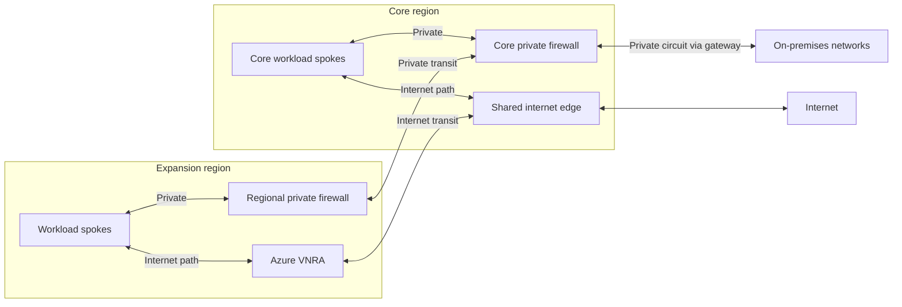

Adding an Azure region doesn't have to mean building a new internet edge on day one. An Azure Virtual Network Routing Appliance (VNRA) can carry internet traffic to an edge in another region while a local firewall handles private traffic. The catch is that the two paths need different routes home, even when the replies are going to the same workload.
<!-- truncate -->

## The default-route lab is the starting point

In my [public preview post](azure-virtual-network-appliance.md), I looked at VNRA as a way to forward traffic between spokes. In my [general availability post](azure-virtual-network-routing-appliance-ga.md#what-i-tested-in-the-lab), I corrected my claim that it couldn't forward a default route to a firewall. A follow-up lab sent internet traffic through a VNRA to a firewall in another region and got the replies back through the same appliance.

That's the lab I'm building on here. It flips the split I recommended in the earlier post: the regional firewall takes private traffic, and the VNRA takes the default route. The VNRA still doesn't translate packets or replace a firewall. What changes is which traffic I ask it to forward and where I send it next.

## Give each region a hub, not necessarily an edge

I use a hub-and-spoke layout in each region. Workloads live in spokes, and each spoke connects only to its own regional hub. I join the hub virtual networks with global virtual network peering and allow forwarded traffic in both directions. Peering isn't transitive: a link between hubs doesn't make their spokes directly reachable. The routing and forwarding rules still have to connect the two sides.

Each hub has a firewall for **east-west** traffic, meaning private flows between workloads or networks. The expansion hub uses VNRA to forward **north-south** traffic, meaning traffic between workloads and the internet in this design. The shared edge firewall does the inspection and translation. By *shared*, I mean shared across regions within one environment, not shared between production and non-production.

The diagram shows one environment. Private traffic crosses the inter-region link between firewalls; internet traffic crosses it between the VNRA and the shared edge. The two paths use the same peering but different next hops.

I repeat the design for production and non-production with separate spokes, hubs, forwarding appliances, firewalls and routing domains. Policies follow the same template, but neither environment learns the other's routes. If both use a shared underlying circuit, I treat route isolation as something to prove, not something the separate hubs guarantee.

## The same destination needs two different routes home

On the spoke subnets, I use user-defined routes (UDRs) to send private destinations to the regional firewall and point the default route at the VNRA. The private routes must cover the destinations that belong on that path, including any on-premises networks. A separate default route on the VNRA subnet points at the shared edge across the peering. The VNRA isn't the next hop for private transit, even though it uses the local peering routes to deliver internet replies to the spokes.

| Where the packet is routed | Destination | Intended next hop |
| --- | --- | --- |
| Expansion spoke | Private destinations | Regional private firewall |
| Expansion spoke | Default | Regional VNRA |
| Regional private firewall | Workloads in another region | Destination region's private firewall over inter-region transport |
| Regional private firewall | On-premises networks in the first stage | Core private firewall, then the private gateway |
| Regional VNRA | Internet-bound traffic | Shared internet edge over global peering |
| Regional VNRA | Local spoke receiving an edge reply | Local spoke peering |
| Core private firewall | Expansion region workloads | Expansion region's private firewall |
| Shared internet edge, on its internal side | The same expansion region workloads | Expansion region's VNRA |

I group each region's spokes under a route summary where the cloud and network plan allow it. That lets the core carry one return route per expansion region and environment **on each of the two paths**. A route that covers only the remote hub can make a hub-level probe pass while leaving its spokes unreachable. I check coverage against every attached spoke, not against the hub alone.

For private flows, the source and destination firewalls both see the session, and replies pass back through them in reverse order. I avoid translation on that path so both policy points can see the original endpoints. For internet flows, the edge uses source network address translation (NAT) to present its public identity. When a reply arrives, the edge reverses that translation and sends it back through the regional VNRA. Sending the reply to the regional private firewall instead gives a stateful device a reply to a session it never saw open.

Where a firewall has its own routing table, I check that table as well as the cloud subnet's effective routes. The device must choose the right interface; the cloud network must then choose the right next hop. A more specific route can win over a summary or a default, so I check learned routes, peering routes and private endpoint routes on the actual source and return subnets. I set route propagation deliberately rather than inheriting it from a template or turning it off across an existing hub that depends on it.

## Keep private transit off the internet path

Two spokes in the same region go through their regional private firewall and stay in the region. Spokes in different regions go through both regional firewalls. For a small number of hubs, I prefer direct links between the pairs that need to talk. A full mesh gets harder to run as the estate grows; a transit fabric can reduce the number of links, but it still has to preserve inspection, environment boundaries and return paths. I don't assume that adding a second expansion hub makes it reachable through the core.

On-premises traffic starts on the private path too. Until a region has its own gateway, the regional firewall sends those flows through the core private firewall and over the existing circuit. The on-premises network needs a return route covering the regional spokes, and traffic coming back from the circuit must enter the core inspection path. I check both what the gateway advertises and what it learns. A shared circuit or remote gateway can make two networks reachable outside the intended inspection path if the routing policy doesn't keep them apart.

Public ingress is a separate choice. Where an application needs it, I keep the approved public entry point and edge policy, then forward from the edge to the application's region. The application's reply needs to return to the same edge flow state for reverse translation. Outbound internet access doesn't imply permission to publish inbound services.

## Centralising the edge buys time, not regional independence

I like this pattern when a region needs to come online before it can support its own internet edge or private circuit. It keeps local traffic local and avoids bringing up another public boundary during the first rollout. The price is a detour for internet traffic and anything that still uses the core private gateway. I measure that cost from a spoke against the application's latency budget, rather than assuming a fast inter-region link makes the detour negligible.

Availability zones can protect against some local failures, but they don't remove the dependency on the core region or the inter-region link. I size the shared edge, transport and gateway for combined demand, including a failure or maintenance window. I also check what changing the egress region would mean for third-party allowlists, geolocation and residency obligations. If the region has to keep internet or on-premises access through a core outage, it needs an independent path or a tested alternate edge. I don't expect connection state or NAT mappings to survive a move unless the design proves it.

VNRA has its own constraints. I check published regional support separately from whether a trial deployment allocates today. I size for throughput, new connections per second and concurrent flows; they don't always grow together. I also check instance limits and leave room for a replacement because VNRA bandwidth can't be changed in place. VNRA doesn't show up as a hop in traceroute, so I use Azure's effective route and next-hop checks and VNRA metrics alongside firewall and workload logs.

## Test where the packets went, not only whether they arrived

I run a small connectivity matrix from workload spokes in every region and environment, not from the hubs. For private HTTPS, I check that DNS selects the intended private service, that TLS validates and that the application responds. An authentication response can prove connectivity without proving the application is ready. For internet HTTPS, I confirm the expected egress identity and match the session and translation in the edge logs. A ping to an approved private test host helps narrow down a fault, but it can't stand in for the application check.

| Test | Evidence I'd expect |
| --- | --- |
| Same-region private connection | The local private firewall sees the flow; no inter-region transit |
| Inter-region private connection | Both private firewalls see the session; the internet edge doesn't |
| Internet connection from an expansion spoke | VNRA is the effective next hop; the shared edge logs the session and translation; neither private firewall sees it |
| On-premises connection and published ingress, where in scope | The expected gateway or edge handles the flow, and replies follow the planned path |
| Cross-environment access or another prohibited flow | The connection fails for the expected reason, with route or policy evidence |
| Link or edge failure and recovery | The flow uses an approved alternate path or fails closed; recovery meets the agreed target |

I record the source region and environment, test time, DNS result, effective routes, application result and matching logs. I tie that evidence to the infrastructure-as-code revision and deployment run, and compare the live configuration with the intended change. A successful request can hide a bypass or an old route that automation didn't remove. I restrict temporary test rules to the test workloads, named destinations and required protocols, and make the rules expire automatically.

Lab results are evidence for the paths exercised, not for untested private circuits, production capacity or the full security policy. A TLS handshake proves the application connection worked; it doesn't demonstrate that the firewall decrypted or inspected the payload. I verify production policy and failure behaviour separately.

## Move the edge and the gateway in separate changes

I start with regional private inspection and shared internet and on-premises paths. When the internet detour or dependency stops being acceptable, I build a regional edge and validate its policy and capacity before steering traffic to it. Then I move the spoke defaults and public ingress in groups, draining sessions where possible and keeping the old return path for workloads that haven't moved. I plan for reconnections where sessions can't drain. Once no workloads or published services depend on the old path, I remove its return routes and retire the VNRA. Per-region ingress and egress remove the internet detour, but they don't change private routing between regions.

I move on-premises traffic separately. A regional gateway may attach to an existing circuit if the transport supports it, but a new gateway doesn't buy dedicated bandwidth or remove a shared circuit failure. I check capacity, attachment limits and route isolation, then coordinate the regional firewall's next hop with what the on-premises routers learn. If the old path is retained for rollback or failover, I make its preference explicit and test both directions before relying on it.

The bit I'd build to last is the spoke's attachment to its regional hub and the inspected path between regions. That lets me change where traffic leaves the cloud without asking application teams to rebuild how they connect to it.
