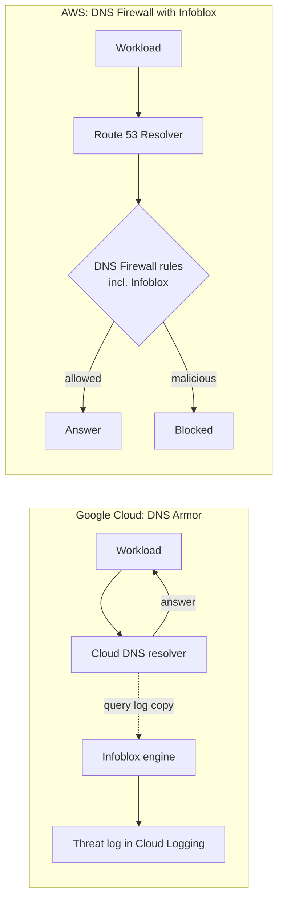

AWS has added Infoblox Threat Defense to Route 53 Resolver DNS Firewall, joining Google Cloud's DNS Armor, which has been available since late 2025. The same threat intelligence now sits inside two hyperscalers, but one watches and the other can block. I spent an evening with the documentation and vendor blogs, then sat in on an industry discussion today. It ran under the Chatham House Rule, so I won't attribute anything I heard there.
<!-- truncate -->

## Protective DNS is a control point

Protective DNS checks a name against threat intelligence before, or after, answering a lookup. If a workload asks for a known malware domain or one that looks algorithmically generated, the resolver can refuse to answer, redirect the request or log it for investigation. The idea is that almost every attack needs a DNS lookup somewhere, making DNS a useful place to catch it early.

The useful questions are where the check happens, what it can see and what it does with a suspicious query.

## Infoblox Threat Defense is the full product

Infoblox Threat Defense, previously called BloxOne Threat Defense in some documentation, is the full platform. It sits in the resolution path: queries go to an Infoblox resolver in its cloud, to an on-premises NIOS appliance, or through an endpoint agent on a roaming laptop. The answer comes back filtered.

DNS Firewall uses Response Policy Zones (RPZ), a DNS feature for rewriting or refusing answers for listed domains. It can block, redirect to a block page or log. Threat Insight adds behavioural detection for DNS tunnelling, algorithmically generated domains and what Infoblox calls Zero Day DNS: treating newly seen domains with suspicion until they build a reputation. TIDE and Dossier provide the threat intelligence exchange and investigation portal, so an analyst can see why a domain was flagged.

One deployment detail I like is the DNS Forwarding Proxy (DFP). It sends queries to Infoblox Cloud over DNS over TLS and includes the original client IP. That means a detection can point to the host that made the query, rather than only to the forwarder.

An endpoint agent isn't required, but it can add context such as which process made a query. I'm wary of adding another agent when most estates already have EDR and observability tools. Reusing existing telemetry is better, though many products still don't export enough detail to connect a process, socket and IP address. That gap needs fixing, not another agent number seven.

## The pitch is pre-emption

The idea is to get in before an attack. Analysis of registration patterns, name servers and other domain details can suggest a name is being prepared for something unpleasant. If so, it can be blocked before it carries a payload.

Someone in the discussion called this “low-regret blocking”. If nothing legitimate uses a new domain with a suspicious profile, blocking it costs little, while offering cover if the name is later confirmed as malicious. One figure quoted was 25 million malicious domains identified in a year, before counting known indicators of compromise.

The argument that landed better with me was about patching. A vulnerability fix can take weeks to arrive, then needs testing. I've seen network teams patch overnight or switch equipment off because no patch existed yet. Blocking attacker infrastructure can buy some cover during that window. It doesn't replace patching, and nobody serious claims it does.

## The numbers need a method

Infoblox's published claims say it blocks malicious domains around 68 days before other tools spot them, with a 0.0002% false-positive rate.

Treat the numbers as marketing until someone publishes the method. A false-positive rate without a denominator is a number, not a fact.

## DNS Armor detects after the answer

Google Cloud's DNS Armor enables a threat detector at project level and sends internet-bound query data to a dedicated Infoblox engine in the same region. Google says analysis happens asynchronously, after Cloud DNS has resolved the query. That avoids adding latency and means a problem with the analysis engine can't break resolution. It also means DNS Armor can't block the answer.

Threat findings appear in Cloud Logging. The detector command is short:

```bash
gcloud network-security dns-threat-detectors create my-detector \
  --location=global \
  --project=my-project \
  --provider="INFOBLOX"
```

Infoblox's general-availability announcement talks about blocking malicious domains, while Google's documentation describes logs. I've followed Google's description because it's Google's resolver, but I'd like either company to confirm the difference.

DNS Armor is a detection service. Its categories include tunnelling, command-and-control (C2), domain generation algorithms (DGAs), fast flux, newly registered domains, lookalikes and exploit kits. If you want to stop traffic, you need a separate response path: Cloud DNS response policies, Cloud NGFW fully qualified domain name (FQDN) rules, or an automated SIEM response are options I'd consider. That's my suggestion, not a Google-documented pattern.

Google publishes exclusions that are worth reading slowly. Cloud Run, Cloud Run functions and App Engine standard aren't inspected. Neither are queries that bypass Cloud DNS, private zones and internal names, or hybrid DNS over VPN or Interconnect. Spoke VPCs that forward internet-bound queries to a hub through DNS peering aren't inspected either. Nor are queries arriving at an inbound forwarding endpoint.

Hub-and-spoke with central DNS is a common landing-zone pattern. If spokes peer a root zone to the hub so resolution happens in one place, DNS Armor doesn't see those queries. If on-premises clients resolve through Cloud DNS, it doesn't see them either. Enable it where queries actually egress, and check that Google supports the path you've built.

This isn't a criticism of the service. It's a reminder that “enable it on the project” and “it's protecting everything” aren't the same sentence.

Managed databases, SaaS back ends and serverless platforms can also hide their resolver from you. Services in your tenant may use the cloud resolver and pass through protection. Services that expose no DNS configuration are a real open question.

The diagram shows the difference: Google analyses a copy after answering, while AWS checks the query before returning an answer.



## AWS puts managed rules in the resolver

AWS's announcement puts Infoblox somewhere quite different: as managed rules inside Route 53 Resolver DNS Firewall. Subscribe to the Infoblox listing in AWS Marketplace, add the managed rules to a rule group, and the resolver filters or blocks queries before answering.

Two things make this a better fit for many designs than DNS Armor. It's inline, so it can stop a query rather than report it later. And hybrid traffic is in scope: AWS says VPC queries and queries from on-premises clients through Route 53 Resolver endpoints can use the same policy.

The DNS Firewall Advanced plan is required, as is a Marketplace subscription. It's separate from Infoblox Universal DDI, which manages DNS. Threat Defense inspects queries for threats. The shared logo doesn't make them the same service.

There's a status wrinkle. AWS's What's New post says preview; the developer guide says generally available. I'd assume preview until AWS sorts out its own pages.

I can't tell how much behavioural detection comes across. The developer guide mentions tunnelling, DGAs and Zero Day DNS, but a managed firewall rule is fundamentally a list. Whether tunnelling detection runs per query inside the resolver or arrives as a continuously updated domain list matters, and the launch material doesn't say.

## Same engine, three shapes

| | DNS Armor (Google Cloud) | Route 53 DNS Firewall + Infoblox (AWS) | Infoblox Threat Defense |
|---|---|---|---|
| Status | GA | Preview* | GA |
| Where it sits | Beside the resolver | In the resolver | Is the resolver |
| What it does | Logs | Filters and blocks | Blocks, redirects, logs |
| Hybrid clients | Not inspected on the listed paths | Via Resolver endpoints | Via DFP or forwarding |
| Investigation | Cloud Logging, your SIEM | Not stated yet | Dossier, SOC Insights |

*The AWS announcement and developer guide disagree on status.

If you're all-in on one cloud, the native option is a natural starting point. In a hybrid or multi-cloud estate, the same Infoblox intelligence can now turn up in three places, with three consoles, log formats and ideas of what “detected” means.

Azure is the gap. A native integration is reportedly in progress, but I haven't seen a date. For now, Azure workloads need Threat Defense itself, via forwarding or DFP.

## We still need a multi-cloud reference design

Each provider documents its own native service. None shows how to combine these services across clouds, which is the design many of us have to build.

Internal DNS delegation between clouds is manageable. Internet egress is harder. Firewalls with FQDN and wildcard rules need to see DNS too, so the resolver and firewall have to agree on the path. Get that wrong and you lose the protective DNS layer or blind the firewall.

Cloud-to-cloud interconnects and cheaper egress make direct traffic between clouds more practical than hairpinning through an on-premises data centre. That makes a consolidated DNS design more important, not less. I'd like a reference architecture for DNS across Azure, AWS and Google Cloud, including multi-cloud estates. I'm not holding my breath.

## None of this works if DNS goes round it

Every one of these products only sees queries that pass through its resolver. Google's exclusions say so directly. AWS and Infoblox say less about it, but the same physics applies.

An application that sends DNS over HTTPS (DoH) directly to a public resolver sails past all three. So does anything with a hard-coded resolver, or malware that connects to an IP address without a lookup. Infoblox has warned about DoH bypass since 2019 and recommends blocking outbound DNS from arbitrary hosts and known DoH endpoints. That's a firewall job, not a DNS one.

Protective DNS is only as good as your control of the DNS path. Filter egress on ports 53 and 853, decide what to do about DoH, and use Discovery of Designated Resolvers (DDR) to point clients at an encrypted resolver you control.

> **For the curious:** DDR lets a client ask its plain-text resolver whether it also offers an encrypted service, via an SVCB record at `_dns.resolver.arpa`. It's a clean way to get encrypted DNS without losing control of where queries go. I've written more about [encrypted DNS](encrypted-dns.md).

## Blocking upstream changes what everyone else sees

One story from the discussion stuck with me. During a pilot, a proxy team noticed a gap in its traffic and needed someone to explain that DNS security had blocked it further upstream. Nothing was broken. The proxy never saw the requests.

Block earlier in the chain and every tool downstream sees less. Tell the teams who own those tools before switching it on. The same organisation started with higher-risk workloads rather than everything, which seems sensible in a hybrid estate.

Overlap is another trap. Many organisations already filter DNS through Cisco Umbrella, Zscaler or an on-premises appliance. Layering another service can mean double blocking and confused responders. Decide which layer owns the decision before adding one.

## What I'd take away

1. Check where queries egress before enabling anything. On Google Cloud, hub-and-spoke peering and hybrid forwarding fall outside DNS Armor.
2. Treat DNS Armor as a detection feed. If you want blocking on Google Cloud, plan the response path before the first alert arrives.
3. Watch before blocking. On AWS, use alert mode first if the managed rules support it; check what would have been blocked before enforcing a block.
4. Tell downstream teams. Proxy, firewall and SOC teams will see less traffic once DNS blocks it.
5. Lock down the DNS path first. Egress filtering and an encrypted DNS strategy come before any of this.
6. Ask for the method behind the numbers. “68 days earlier” and a tiny false-positive rate are vendor claims. Ask how they're measured, and ask for the false-negative rate.

## Sources

- [Google Cloud: Advanced threat detection with DNS Armor](https://docs.cloud.google.com/dns/docs/threat-detection)
- [Google Cloud: Create a DNS threat detector](https://docs.cloud.google.com/dns/docs/create-threat-detector)
- [Infoblox: DNS Armor now generally available](https://www.infoblox.com/blog/security/dns-armor-now-generally-available/)
- [AWS What's New: Route 53 DNS Firewall supports Infoblox Threat Defense (preview)](https://aws.amazon.com/about-aws/whats-new/2026/11/route53-dns-firewall-infoblox-preview/)
- [AWS: Infoblox DNS threat protection in DNS Firewall](https://docs.aws.amazon.com/Route53/latest/DeveloperGuide/firewall-partner-infoblox.html)
- [Infoblox: Threat Defense datasheet](https://www.infoblox.com/resources/datasheets/infoblox-threat-defense)
- [Infoblox: DNS Forwarding Proxy documentation](https://infoblox-docs.atlassian.net/wiki/x/nAWCMg)
- [Infoblox: DoT and DoH mitigation guide](https://www.infoblox.com/wp-content/uploads/infoblox-deployment-guide-dot-and-doh-mitigation-guide.pdf)
- [iTWire: Infoblox Threat Defense announcements, August 2025](https://itwire.com/business-it-news/security/infoblox-supercharges-threat-defense-to-deliver-enhanced-preemptive-protection-against-sophisticated,-ai-driven-attacks)
