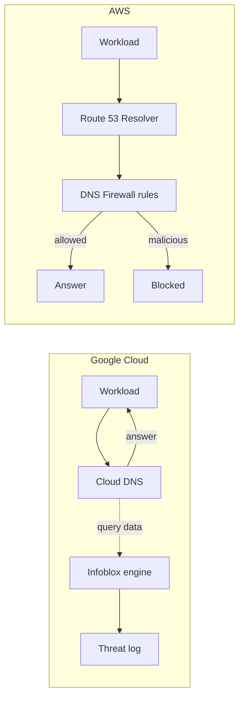

I compared the new Route 53 Resolver DNS Firewall integration with Google Cloud's DNS Armor, and the important difference isn't the vendor name. Google's service reports suspicious lookups after resolution; AWS puts Infoblox-managed rules in the resolver path, where they can block them. That changes the design question from “which feed is better?” to “does this service see the queries I care about?”
<!-- truncate -->

## The resolver is the control point

Protective DNS checks a lookup against threat intelligence and can log, refuse or redirect a suspicious query. The check only helps when the workload uses the resolver that performs it. Same threat intelligence doesn't mean the same service or the same result.

Infoblox Threat Defense is the wider platform behind these integrations. Google and AWS bring parts of its intelligence into their own DNS services, but they put the check in different places.

## Google detects after the answer

Google Cloud's DNS Armor sends internet-bound DNS query data to a dedicated Infoblox engine in the same region. The analysis runs asynchronously after Cloud DNS has resolved the query. Google says this adds no latency to resolution, but it also means DNS Armor itself can't block the answer.

Threat findings go to Cloud Logging. The detector is configured at project level, but threat checking supports Compute Engine and GKE workloads, not every service or every query in a project. Google's exclusions include serverless workloads, traffic that bypasses Cloud DNS, DNS peering (including internet-bound queries forwarded from spokes), private and internal names, and hybrid DNS over Cloud VPN or Cloud Interconnect.

The command to create a detector is short:

```bash
gcloud network-security dns-threat-detectors create my-detector \
  --location=global \
  --project=my-project \
  --provider="INFOBLOX"
```

If you want to block a query in Google Cloud, you need a separate response path, such as a DNS response policy or an automated security workflow. DNS Armor is a detection feed, not an inline firewall.

## AWS puts managed rules in the resolver

AWS announced Infoblox Threat Defense for Route 53 Resolver DNS Firewall in November 2026. You subscribe to the Marketplace listing and add Infoblox managed rules to a DNS Firewall rule group. AWS says those rules can filter or block queries from VPCs and hybrid networks that forward DNS through Route 53 Resolver endpoints. The Advanced plan is required.

AWS describes detections by threat level and type, including DNS tunnelling, domain generation algorithms (DGAs) and Zero Day DNS. The integration can act before a response reaches the client, unlike DNS Armor's after-resolution analysis. The launch material doesn't explain whether every behavioural detection runs in the resolver or arrives as an updated indicator, so I wouldn't assume the managed rules reproduce every part of the full Threat Defense platform.

There's a status wrinkle. AWS's [What's New announcement](https://aws.amazon.com/about-aws/whats-new/2026/11/route53-dns-firewall-infoblox-preview/) calls the service a preview and says the Marketplace subscription is free during preview. The [Route 53 developer guide](https://docs.aws.amazon.com/Route53/latest/DeveloperGuide/firewall-partner-infoblox.html) says it's generally available. As of 17 November 2026, AWS's own pages disagree; check the Marketplace listing for current availability and pricing.

The placement is easier to see in a diagram. Google copies query data for analysis after Cloud DNS has answered; AWS evaluates the request in DNS Firewall before it returns an answer.



| | DNS Armor | Route 53 DNS Firewall + Infoblox |
| --- | --- | --- |
| Where the check runs | After resolution | In the resolver path |
| What it can do | Log a finding | Allow or block, based on the rule |
| Coverage to check | Supported workloads and DNS paths | VPCs and hybrid traffic via Resolver endpoints |
| Published status | Generally available | AWS announcement says preview; guide says GA |

## None of this works if DNS goes round it

An application that sends DNS over HTTPS (DoH) directly to a public resolver can bypass both services. So can a workload that sends queries to another resolver instead of the one your cloud policy protects. DNS security depends on controlling the path, not only enabling a detector or rule group.

Restrict outbound DNS and DNS over TLS to approved resolvers, and use endpoint or network controls to manage DoH. Google's exclusion list is a useful reminder to trace the real path: a spoke query forwarded to a hub through DNS peering isn't inspected by DNS Armor, even if it eventually resolves an internet name.

Infoblox's datasheet claims its platform detects threats an average of 68.4 days before other tools and has a 0.0002% false-positive rate. Those are vendor figures, not independent measurements I've verified. They don't tell you which integration fits your design; resolver placement and coverage do.

## What I'd take away

1. Map where queries actually resolve before enabling either service. Check spokes, private zones, hybrid forwarding and resolver bypass.
2. Treat DNS Armor as detection. If you need blocking in Google Cloud, design and test a separate response.
3. On AWS, check the current status and Marketplace terms, then start with a non-blocking action if the managed rules support one.
4. Control direct DNS and DoH paths. A protective resolver can't inspect a query it never receives.

## Sources

- [Google Cloud: Advanced threat detection with DNS Armor](https://docs.cloud.google.com/dns/docs/threat-detection)
- [Google Cloud: Create a DNS threat detector](https://docs.cloud.google.com/dns/docs/create-threat-detector)
- [Infoblox: DNS Armor now generally available](https://www.infoblox.com/blog/security/dns-armor-now-generally-available/)
- [AWS What's New: Route 53 DNS Firewall supports Infoblox Threat Defense](https://aws.amazon.com/about-aws/whats-new/2026/11/route53-dns-firewall-infoblox-preview/)
- [AWS: Infoblox DNS threat protection in DNS Firewall](https://docs.aws.amazon.com/Route53/latest/DeveloperGuide/firewall-partner-infoblox.html)
- [Infoblox: Threat Defense datasheet](https://www.infoblox.com/resources/datasheets/infoblox-threat-defense)
- [Infoblox: DoT and DoH mitigation guide](https://www.infoblox.com/wp-content/uploads/infoblox-deployment-guide-dot-and-doh-mitigation-guide.pdf)
